<picture>
  <source media="(prefers-color-scheme: dark)" srcset="./assets/fathom-hero-dark.svg">
  
</picture>

<b>AswinHari2000</b> ·  Flutter Developer | Building Beautiful, Responsive &amp; High-Performance Cross-Platform Mobile Applications with Dart

<a href="mailto:aswin.h@sigainfotech.com">aswin.h@sigainfotech.com</a>

**On the surface.** Flutter Developer passionate about building beautiful, responsive, and high-performance mobile applications. Skilled in Dart, Flutter, API integration, and creating seamless user experiences.  Always learning, building, and exploring new technologies.

**Currently diving into:** Float Pro

#### Dive log

<picture>
  <source media="(prefers-color-scheme: dark)" srcset="./assets/fathom-log-dark.svg">
  
</picture>

Reading the dive log

- **Depth:** one metre per contribution in the last 12 months. 82 m puts you in the sunlit zone. The zones are the ocean’s real ones: sunlit to 200 m, twilight to 1,000 m, midnight to 4,000 m, abyssal to 6,000 m and hadal below that, down to the Challenger Deep at 10,935 m.
- **The descent:** your year as one dive, left to right. The line drops as contributions add up and runs flat through breaks. Each bubble is an active day; bigger bubbles are busier days.
- **Logbook:** bottom time is active days, longest dive is the longest streak, safety stop is the longest break, visibility is followers, treasure is stars, and time in the water is years on GitHub.
- **Species spotted:** language share by bytes across public repositories. The Latin is made up.
- **On sonar:** featured repositories. The nearer the centre, the more stars.
- **The opening shot:** the reef is the last 52 weeks, one coral per week. Taller corals are busier weeks, and each glowing polyp is one active day. The fish are featured repositories, sized by stars.

Artwork: original animated SVG, generated by README Templates · template: Fathom. Motion stops if your system asks for reduced motion.

<picture>
  <source media="(prefers-color-scheme: dark)" srcset="./assets/fathom-end-dark.svg">
  
</picture>

